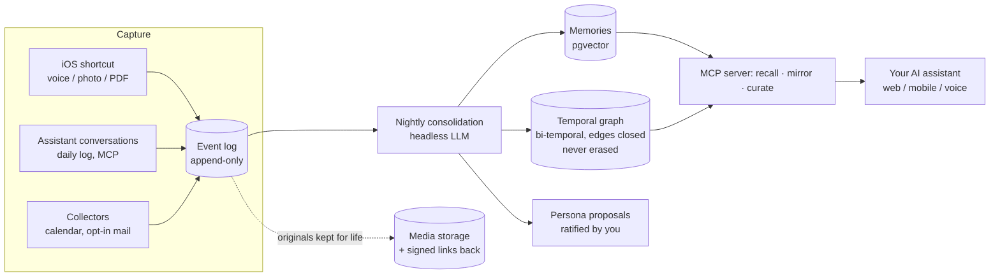

# Souvenance

> **A personal memory that invents nothing, and proves it.**

Souvenance is an independent, open-source research lab on AI memory, and the engine it uses as a
test bed. AI assistants now write memories about their users on their own; some of those memories
rest on nothing the user said. This project builds and measures the opposite: a personal memory in
which **every entry quotes the words it came from, checked in code before it is written**, and in
which nothing is silently overwritten.

[Website](https://souvenance.me) · [Research](https://souvenance.me/research) ·
[SOURCED benchmark (in preparation)](https://souvenance.me/benchmark) · [Related work](https://souvenance.me/related-work) ·
[Lab notes](https://souvenance.me/lab)

## Why

Every AI lab is building a memory of you, and none of them will ever make it portable: **your
accumulated context is their lock-in**. A 2026 study of ChatGPT memories found 96% were created
unilaterally by the system, and half contained psychological inferences. *A profile of you, written
without you, held by someone else.*

Meanwhile frontier intelligence is becoming a commodity. What gains value is your context: what you
decided, what you believed, how you changed. **Compute can be rented; context can be owned.** Souvenance
takes the opposite position: an open, self-hosted memory engine in which the AI is a replaceable
adapter and the memory is yours — auditable, exportable, governed by you.

## What is new, and what is not

| | |
|---|---|
| **Claimed** (to be measured publicly) | A write-time **admission cascade** — excerpt verified in code, then numbers and proper nouns, then a model re-read of flagged cases only — with the invention rate it lets through measured and published · a **fidelity harness** · **autobiographical lived time** (life landmarks and chapters as coordinates, computed in code) · **consent governance** (persona never self-ratified, too-fast confirmations refused, visible log of agent reads, no outbound channel) |
| **Prior art**, implemented with credit | Append-only log with memories as projections (event sourcing) · bi-temporal graph with invalidation ([Zep / Graphiti, arXiv 2501.13956](https://arxiv.org/abs/2501.13956)) · background consolidation (OpenClaw dreaming; [sleep-time compute, arXiv 2504.13171](https://arxiv.org/abs/2504.13171)) · Hebbian links ([HeLa-Mem, arXiv 2604.16839](https://arxiv.org/abs/2604.16839)) · forgetting curves ([MemoryBank, arXiv 2305.10250](https://arxiv.org/abs/2305.10250)) |

SOURCED, the benchmark in preparation ([`research/benchmarks/sourced`](research/benchmarks/sourced)), extends [HaluMem (arXiv 2511.03506)](https://arxiv.org/abs/2511.03506);
it is not the first benchmark of hallucinations in memory systems.

## Results so far

| Question | Finding | Status |
|---|---|---|
| Invention rate of the production model at write time | 0 / 42 memories rated invented | Pilot: 5 nights of the author's private data, one LLM judge — a signal, not a result ([notes](research/evals/frugal/RESULTATS.md)) |
| Same, small open models (3–9B) on a laptop | 5–20% | Same pilot |
| Time framing computed in code vs raw timestamps (LoCoMo) | — | Pre-registered, not run ([protocol](research/papers/002-lived-time/README.md)) |
| Integrity of memory systems on public data | — | SOURCED benchmark in preparation |

No other number exists yet. When one does, it is published with its protocol, sample size and code.

## Papers

- **001 — Own the substrate** (essay, draft v0.2): a personal memory should be an append-only log
  owned by its subject, with every AI layer a recomputable projection. [Paper](research/papers/001-substrate-thesis/paper.md) ·
  [verified and rejected sources](research/papers/001-substrate-thesis/references.bib)
- **002 — Lived time** (pre-registered protocol): an ablation on LoCoMo with five conditions, including
  a token-matched placebo, across model sizes. [Protocol](research/papers/002-lived-time/README.md)

Standards: [research/README.md](research/README.md). To cite: GitHub's "Cite this repository" button
([CITATION.cff](CITATION.cff)).

## Run the engine

Docker on a Mac, a Linux PC or a NAS. Any AI backend: a CLI, an API key, or a local open model behind an
OpenAI-compatible endpoint (LM Studio, Ollama, mlx, vLLM).

```bash
git clone https://github.com/Pensine/souvenance.me souvenance && cd souvenance
python3 scripts/setup.py        # choose the AI backend, generate secrets
docker compose up -d --build
```

Step by step, tunnel and troubleshooting: [docs/installer-chez-soi.md](docs/installer-chez-soi.md).
On a Debian or Ubuntu server without Docker: `./install.sh --with-local`, guide in
[docs/kit-installation.md](docs/kit-installation.md). Then add the MCP server as a connector in any
assistant that supports remote MCP.

Running cost: **about zero** beyond your server — the AI layer uses access you already have (a
subscription CLI or an API key, swappable at any time), or runs entirely locally.

A turnkey install kit, paid once, exists for those who would rather not set it up by hand; it supports
the lab and contains nothing that is not in this repository.

## What the engine does

- **Capture without effort** — an iOS share-sheet shortcut: two taps and a voice note, a photo or a
  PDF is archived for good and transcribed word for word overnight. A two-minute spoken daily log.
  Collectors that quietly pull in your personal calendar. *Memory is never a chore; it is the
  by-product of useful tools.*
- **Query your past** — from any MCP client, on the web, on mobile or by voice: *"What did I think of X
  last year?"* Hybrid retrieval: vectors, a temporal knowledge graph and a time frame computed in code
  ("14 months ago, two summers back").
- **Relive, not only remember** — `recall` returns the synthesis *and* a temporary signed link to the
  original audio: one tap and you hear your own voice from that morning, doubts included. A timeline
  web app to browse everything.
- **A memory that sleeps** — nightly consolidation (extraction, importance scoring, contradiction
  detection, active forgetting) and a weekly REM-style recombination across areas of life, on top of
  an **append-only event log**: a better engine in 2028 can re-read your whole life.
- **A narrative identity you author** — the persona compiler drafts your story (chapters, themes,
  tensions you accept), each claim weighed and sourced. Nothing takes effect until you ratify it.
  Versioned in Git.
- **A mirror, never an oracle** — on request, and only on request: *"What do my last six months say
  about my priorities?"* The system reports; it does not judge, prescribes nothing, and leaves the
  conclusion to you.
- **Measured, not assumed** — a fidelity harness questions your twin blind against its own memory and
  scores it per area of life. Trust is earned by measurement, never by elapsed time.



One PostgreSQL database (pgvector included). No graph database, no vector database, no queue — boring,
proven, built to last 20 years.

## Architecture

| Path | Role |
|---|---|
| `db/schema.sql` | Append-only event log (SQL trigger), memories (pgvector), bi-temporal graph, audit |
| `pensine/evidence.py` | Admission cascade: excerpt, details, re-read |
| `pensine/temporal.py` | Time framing computed in code: durations, landmarks, chapters, plans |
| `pensine/mcp_server.py` | MCP server: recall, timeline, daily log, proposals the user confirms |
| `pensine/api.py` | Phone deposits (`POST /deposit`), signed media links |
| `pensine/llm.py` | AI adapter: CLI, API, OpenAI-compatible (local or remote), Ollama, fake (tests) |
| `pensine/governor.py`, `constitution.yaml` | Executable constitution: exclusions, outbound actions refused, audit |
| `consolidation/nightly.py`, `rem_weekly.py` | Nightly consolidation and weekly recombination; persona proposals never self-ratified |
| `research/` | Papers, protocols, evaluation harnesses |
| `marketing/pages/`, `scripts/build_site_pages.py` | Source of souvenance.me |

## Rules enforced in code

- **Append-only**: `events` accepts neither `UPDATE` nor `DELETE`.
- **No memory without an excerpt** found in the source.
- **Originals kept as received**; transcripts and descriptions are catalogue entries.
- **The persona is never self-ratified.**
- **Silence**: the system never invites you back — no notification channel exists, and the governor
  refuses every outbound action.
- **Exclusion perimeter**: `constitution.yaml` filters ingestion; every refusal is audited.
- **Third-party rule**: other people's intimate conversations are summarised, never kept verbatim; the
  channel's sender takes precedence over a voiceprint.
- **Pause, never loss**: if the AI layer fails, events accumulate and consolidation catches up.

## How it differs from…

- **Built-in ChatGPT / Claude memory** — theirs is opaque, not portable, not auditable. Here the SQL
  dump *is* the export, and the adapter removes model lock-in.
- **StoryWorth, HereAfter and other legacy apps** — memory *for others, after you*. This is memory
  *for you, while you live* — which still becomes a living autobiography: your voice at the time,
  before your future self rewrites the past.
- **Agent frameworks with memory bolted on** — this is memory first: no outbound action in v1, by
  constitution. The archive is the product.

## FAQ

**Am I talking "to a twin"?** No. You talk to your usual assistant; the other party stays alive and
interchangeable. The memory engine is the back room.

**What if I stop paying for my AI provider?** Capture never depends on the AI layer. Events accumulate,
and consolidation resumes when compute comes back. The worst case is a pause, never a loss.

**What happens to my data when I die?** A template of testamentary clauses is public
([docs/clauses-testamentaires.md](docs/clauses-testamentaires.md)): extinction, a read-only memorial,
or a deferred bequest — decided in advance, with a cool head, by you.

**Why do the first weeks feel modest?** Because the value compounds: close to nothing at six months,
considerable at ten years. The founding interview (four scripted sessions,
[docs/interview-fondatrice.md](docs/interview-fondatrice.md)) seeds the corpus from day one.

## License

Code: [Apache License 2.0](LICENSE) — see also [NOTICE](NOTICE). Research papers, lab notes and other
research prose, and the SOURCED benchmark data: [Creative Commons Attribution 4.0 (CC BY 4.0)](https://creativecommons.org/licenses/by/4.0/).
Language models assisted with drafting, code and literature synthesis; every claim is
the author's responsibility (see each paper's disclosure section).
