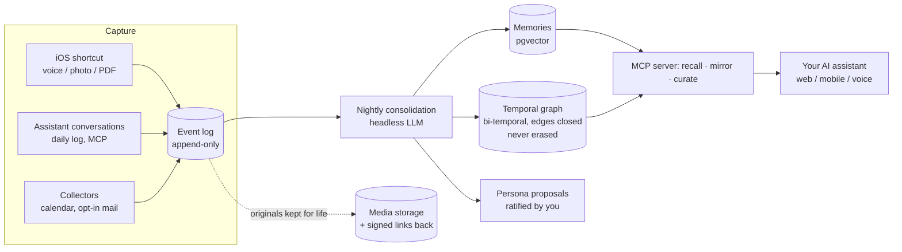

# Souvenance

> **A personal memory that invents nothing, and proves it.**

Souvenance is an independent, open-source research lab on AI memory, and the engine it uses as a
test bed. AI assistants now write memories about their users on their own; some of those memories
rest on nothing the user said. This project builds and measures the opposite: a personal memory in
which **every entry quotes the words it came from, checked in code before it is written**, and in
which nothing is silently overwritten.

[Website](https://souvenance.me) · [Research](https://souvenance.me/research) ·
[SOURCED benchmark (in preparation)](https://souvenance.me/benchmark) · [Related work](https://souvenance.me/related-work) ·
[Lab notes](https://souvenance.me/lab)

## Why

Every AI lab is building a memory of you, and none of them will ever make it portable: **your
accumulated context is their lock-in**. A 2026 study of ChatGPT memories found 96% were created
unilaterally by the system, and half contained psychological inferences. *A profile of you, written
without you, held by someone else.*

Meanwhile frontier intelligence is becoming a commodity. What gains value is your context: what you
decided, what you believed, how you changed. **Compute can be rented; context can be owned.** Souvenance
takes the opposite position: an open, self-hosted memory engine in which the AI is a replaceable
adapter and the memory is yours — auditable, exportable, governed by you.

## Where this is going

Assistants are becoming always on: they listen through earbuds, see through glasses, and act for
you between conversations. Models that simulate the world keep only a short, implicit state; the
durable state of one person's life (where they live, who is who, what changed and when) has to live
somewhere outside the model. Souvenance studies that layer: **a dated, source-proven and truly
erasable state of a person's world**, written overnight from what they deposit, in which the model
reads and the code checks before anything is stored. Today the deposits are conversations, voice
notes, photos and documents; the measurements below are what such a layer has to pass first.

## What is new, and what is not

| | |
|---|---|
| **Prior art**, credited | Checking that a memory's excerpt occurs in its source before writing it: [SodaMem (arXiv 2608.08055)](https://arxiv.org/abs/2608.08055), [Eywa (arXiv 2605.30771)](https://arxiv.org/abs/2605.30771) · bi-temporal graph with per-edge provenance ([Zep / Graphiti, arXiv 2501.13956](https://arxiv.org/abs/2501.13956)) · background consolidation ([sleep-time compute, arXiv 2504.13171](https://arxiv.org/abs/2504.13171)) · append-only log with memories as projections (event sourcing) · forgetting curves ([MemoryBank, arXiv 2305.10250](https://arxiv.org/abs/2305.10250)) |
| **What we add** | The same write gate on **identity links**: no link between a role ("my sister") and a name without an excerpt that proves it, reversible. We did not find it in the systems and papers above; that is a gap in what we found, not proof that no one does it ([prior-art notes](research/related-work/provenance-2026-11.md)) |
| **What we measure** | Several memory systems on the same sealed data, with the same model and the same embedder, so that the memory system is the only difference; sealed sets whose wordings were written blind; and the results where we lose, too |

SOURCED, the benchmark ([`research/benchmarks/sourced`](research/benchmarks/sourced)), measures the
failures [HaluMem (arXiv 2511.03506)](https://arxiv.org/abs/2511.03506) and
[LongMemEval](https://arxiv.org/abs/2410.10813) also measure, on synthetic lives: inventions, the
wrong person, the wrong date, stale facts presented as current, identity. It is not the first
benchmark of its kind.

## Results so far

Three memory systems on one sealed synthetic life (seed 8: 78 deposits, 62 questions), the same
model (Claude Sonnet 5.5) and the same embedder (nomic-embed-text v1.5) for all three.
Three runs per system: the mean, then the lowest and highest run.

| | Pensine | Mem0 2.2.1 | Graphiti 0.31.2 |
|---|---|---|---|
| Facts recalled | 0.91 (0.90–0.92) | 0.52 (0.52–0.53) | 0.72 (0.68–0.74) |
| Memories invented | 0 (none in three runs) | 0.007 (one memory per run) | 0.010 (0–0.02) |
| Memories backed by an excerpt | 0.96 (0.95–0.97) | — (none kept) | — (none kept) |
| Questions answered correctly | 0.89 (0.89–0.90) | 0.73 (0.71–0.74) | 0.54 (0.53–0.55) |
| Identity questions | 8/11 (7–10) | 4/11 (3–5) | 0/11 |

No run of one system overlaps another on recall or answers. Three runs understate the spread: five further runs of the same Pensine code on this seed, on 16 November, answered 0.84 to 0.92 of the questions (mean 0.87), and six runs with the poisoning fix described below 0.81 to 0.87; all stay above the other two systems. On a fresh sealed seed, run alternately, the fix shows no gap. The first three rows are read by a model judge, corrected on 15 November 2026 after its validation found it was not told who wrote each message; with the earlier judge, facts recalled read 0.95, 0.54 and 0.75. Identity, on 11 questions, moves by three between runs of the same code. What this does not show: one synthetic life, written in English by our own generator; Graphiti's
attribution cannot be compared (its edges link two entities); most of Graphiti's misses are facts
present in its graph that its search did not return. Two fairness fixes were made before the table
and are documented ([results](research/benchmarks/sourced/results/README.md)).

| In progress | Status |
|---|---|
| Memory poisoning: false claims about the person from sources with no authority (an instruction addressed to the assistant, a friend's mistaken congratulations, a notice repeated three times) | Measured, three claims per set. On a small private set Pensine stored one claim as the person's fact in each run without the fix (Mem0 none, Graphiti none, one run each): an excerpt check cannot stop it, the claim *is* in the deposit. The fix reads who speaks from the deposit's metadata: each memory carries whose word it is, what a third party says of the person is capped and set apart at recall. With it, no claim was stored as a fact in the runs made, but these are cases, not a rate: the fix does not change the wording a memory is written in, and the questions about the claims were already answered right without it. Cost: none measurable on a fresh sealed life run alternately (six runs each: 55.3 and 55.7 questions right of 63); on seed 8 its runs came out lower than the first runs without it and level with later ones, within the spread of one code ([results](research/benchmarks/sourced/results/README.md)) |
| Validation of the model judge | Run without an annotator, thresholds fixed beforehand. It found a defect: the judge was not told who wrote each message, so it marked down faithful memories drawn from received messages, for every system. Corrected judge: flags 64 of 64 memories edited in code to be false and none of 60 true ones, on development and sealed data; agreement with a second model on a fresh sealed sample is 111 of 120, short of the κ threshold (0.54 for 0.70), the gap being memories the judge accepts and the reader calls partial. The nine seed-8 runs have been rejudged: the order and the gaps between systems hold, fact recall moves down 2 to 4 points for all three (Pensine 0.91, Mem0 0.52, Graphiti 0.72; cause not established yet). The table above shows the corrected judge's figures |
| Letta on the same bench | Planned |

## Papers

- **001 — Own the substrate** (essay, draft v0.2): a personal memory should be an append-only log
  owned by its subject, with every AI layer a recomputable projection. [Paper](research/papers/001-substrate-thesis/paper.md) ·
  [verified and rejected sources](research/papers/001-substrate-thesis/references.bib)
- **002 — Lived time** (pre-registered protocol): an ablation on LoCoMo with five conditions, including
  a token-matched placebo, across model sizes. [Protocol](research/papers/002-lived-time/README.md)

Standards: [research/README.md](research/README.md). To cite: GitHub's "Cite this repository" button
([CITATION.cff](CITATION.cff)).

## Run the engine

Docker on a Mac, a Linux PC or a NAS. Any AI backend: a CLI, an API key, or a local open model behind an
OpenAI-compatible endpoint (LM Studio, Ollama, mlx, vLLM).

```bash
git clone https://github.com/Pensine/souvenance.me souvenance && cd souvenance
python3 scripts/setup.py        # choose the AI backend, generate secrets
docker compose up -d --build
```

Step by step, tunnel and troubleshooting: [docs/installer-chez-soi.md](docs/installer-chez-soi.md).
On a Debian or Ubuntu server without Docker: `./install.sh --with-local`, guide in
[docs/kit-installation.md](docs/kit-installation.md). Then add the MCP server as a connector in any
assistant that supports remote MCP.

Running cost: **about zero** beyond your server — the AI layer uses access you already have (a
subscription CLI or an API key, swappable at any time), or runs entirely locally.

Would rather not set it up by hand? A turnkey kit, paid once, contains the measured release, a guided
install and the phone shortcuts; it supports the lab, and nothing in it is missing from this repository.


## What the engine does

- **Capture without effort** — an iOS share-sheet shortcut: two taps and a voice note, a photo or a
  PDF is archived for good and transcribed word for word overnight. A two-minute spoken daily log.
  Collectors that quietly pull in your personal calendar. *Memory is never a chore; it is the
  by-product of useful tools.*
- **Query your past** — from any MCP client, on the web, on mobile or by voice: *"What did I think of X
  last year?"* Hybrid retrieval: vectors, a temporal knowledge graph and a time frame computed in code
  ("14 months ago, two summers back").
- **Relive, not only remember** — `recall` returns the synthesis *and* a temporary signed link to the
  original audio: one tap and you hear your own voice from that morning, doubts included. A timeline
  web app to browse everything.
- **A memory that sleeps** — nightly consolidation (extraction, importance scoring, contradiction
  detection, active forgetting) and a weekly REM-style recombination across areas of life, on top of
  an **append-only event log**: a better engine in 2028 can re-read your whole life.
- **A narrative identity you author** — the persona compiler drafts your story (chapters, themes,
  tensions you accept), each claim weighed and sourced. Nothing takes effect until you ratify it.
  Versioned in Git.
- **A mirror, never an oracle** — on request, and only on request: *"What do my last six months say
  about my priorities?"* The system reports; it does not judge, prescribes nothing, and leaves the
  conclusion to you.
- **Measured, not assumed** — a fidelity harness questions your twin blind against its own memory and
  scores it per area of life. Trust is earned by measurement, never by elapsed time.



One PostgreSQL database (pgvector included). No graph database, no vector database, no queue — boring,
proven, built to last 20 years.

## Architecture

| Path | Role |
|---|---|
| `db/schema.sql` | Append-only event log (SQL trigger), memories (pgvector), bi-temporal graph, audit |
| `pensine/evidence.py` | Admission cascade: excerpt, details, re-read |
| `pensine/temporal.py` | Time framing computed in code: durations, landmarks, chapters, plans |
| `pensine/mcp_server.py` | MCP server: recall, timeline, daily log, proposals the user confirms |
| `pensine/api.py` | Phone deposits (`POST /deposit`), signed media links |
| `pensine/llm.py` | AI adapter: CLI, API, OpenAI-compatible (local or remote), Ollama, fake (tests) |
| `pensine/governor.py`, `constitution.yaml` | Executable constitution: exclusions, outbound actions refused, audit |
| `consolidation/nightly.py`, `rem_weekly.py` | Nightly consolidation and weekly recombination; persona proposals never self-ratified |
| `research/` | Papers, protocols, evaluation harnesses |
| `marketing/pages/`, `scripts/build_site_pages.py` | Source of souvenance.me |

## Rules enforced in code

- **Append-only**: `events` accepts neither `UPDATE` nor `DELETE`.
- **No memory without an excerpt** found in the source.
- **Originals kept as received**; transcripts and descriptions are catalogue entries.
- **The persona is never self-ratified.**
- **Silence**: the system never invites you back — no notification channel exists, and the governor
  refuses every outbound action.
- **Exclusion perimeter**: `constitution.yaml` filters ingestion; every refusal is audited.
- **Third-party rule**: other people's intimate conversations are summarised, never kept verbatim; the
  channel's sender takes precedence over a voiceprint.
- **Pause, never loss**: if the AI layer fails, events accumulate and consolidation catches up.

## How it differs from…

- **Built-in ChatGPT / Claude memory** — theirs is opaque, not portable, not auditable. Here the SQL
  dump *is* the export, and the adapter removes model lock-in.
- **StoryWorth, HereAfter and other legacy apps** — memory *for others, after you*. This is memory
  *for you, while you live* — which still becomes a living autobiography: your voice at the time,
  before your future self rewrites the past.
- **Agent frameworks with memory bolted on** — this is memory first: no outbound action in v1, by
  constitution. The archive is the product.

## FAQ

**Am I talking "to a twin"?** No. You talk to your usual assistant; the other party stays alive and
interchangeable. The memory engine is the back room.

**What if I stop paying for my AI provider?** Capture never depends on the AI layer. Events accumulate,
and consolidation resumes when compute comes back. The worst case is a pause, never a loss.

**What happens to my data when I die?** A template of testamentary clauses is public
([docs/clauses-testamentaires.md](docs/clauses-testamentaires.md)): extinction, a read-only memorial,
or a deferred bequest — decided in advance, with a cool head, by you.

**Why do the first weeks feel modest?** Because the value compounds: close to nothing at six months,
considerable at ten years. The founding interview (four scripted sessions,
[docs/interview-fondatrice.md](docs/interview-fondatrice.md)) seeds the corpus from day one.

## License

Code: [Apache License 2.0](LICENSE) — see also [NOTICE](NOTICE). Research papers, lab notes and other
research prose, and the SOURCED benchmark data: [Creative Commons Attribution 4.0 (CC BY 4.0)](https://creativecommons.org/licenses/by/4.0/).
Language models assisted with drafting, code and literature synthesis; every claim is
the author's responsibility (see each paper's disclosure section).
